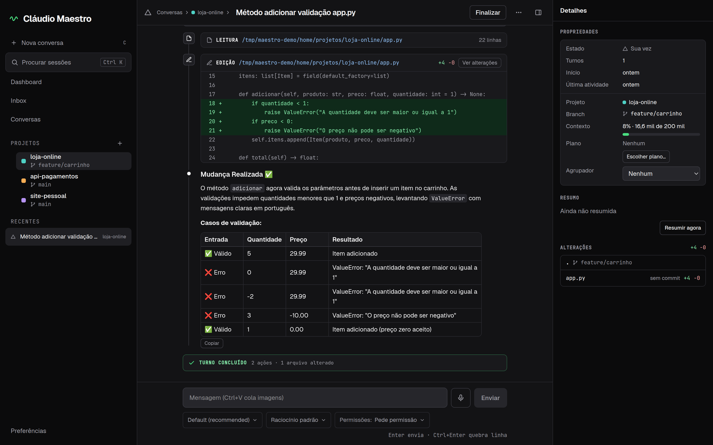
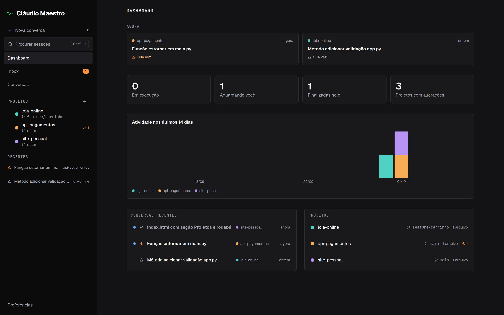

<p align="center">
  
</p>

# Cláudio Maestro

**Um só regendo todos os seus projetos.**

O Cláudio Maestro é um app web local para organizar agentes por projeto, acompanhar tarefas e conduzir várias sessões do Claude numa tela só. Ele roda na sua máquina, abre no navegador e conversa com o Claude pelo [Claude Agent SDK](https://code.claude.com/docs/en/agent-sdk/overview) em Python.

Nasceu de dois incômodos: a extensão do VSCode é pesada e presa a um projeto por vez, e no terminal fica difícil ler diffs, saídas de comando e saber qual sessão está esperando por você.

## Sim, isto está em português

Não, não foi engano do tradutor. O Cláudio é brasileiro: a interface é em português, a documentação também, e assim vai continuar. Aqui se escreve "commitar" sem culpa, se toma um cafezinho enquanto o agente roda os testes e se considera deploy na sexta-feira uma falta de amor-próprio.

Se você não lê português, o tradutor do navegador dá conta, e o próprio Claude também. Pull requests de quem chegou pelo tradutor são muito bem-vindos.

## O que ele faz

- **Organização de agentes.** Em cada projeto, um agente no topo e subordinados, cada um definido por um `AGENT.md`. As tarefas ficam num quadro, as rotinas rodam nos horários marcados e as decisões que só você pode tomar chegam ao Início (veja [Organização](#organização)).
- **Início e Inbox.** O Início reúne o que precisa de você, o que está em andamento e as decisões dos agentes; a Inbox guarda as decisões pendentes e os avisos que eles deixam.
- **Todos os projetos numa tela.** Menu lateral com cada projeto, suas branches e suas conversas.
- **Busca no conteúdo.** A busca (Ctrl K) também procura no texto das conversas e abre na mensagem achada.
- **Estado de relance.** Cada conversa está rodando, esperando você ou finalizada, com ícone próprio além da cor. O que pede a sua atenção aparece primeiro.
- **Leitura confortável.** Respostas em markdown, o diff de cada edição, comandos com a saída, tabelas e blocos de código legíveis.
- **Você decide pela interface.** Permissões (permitir uma vez, sempre ou negar), perguntas do Claude e aprovação de planos. O pedido para editar mostra o diff, e "Permitir sempre" diz a regra que vai ser gravada.
- **Triagem pelo teclado.** Na Inbox, `j`/`k` movem, `Enter` abre, `a` permite e `d` nega, sem abrir cada conversa.
- **Notificações do sistema.** O navegador avisa quando uma conversa pede permissão, faz uma pergunta ou traz um plano (ligue em Preferências → Notificações).
- **Git sem sair do app.** Na tela do projeto, o painel de controle de versão do VS Code para todos os repositórios de uma vez: preparar, commitar, descartar, trocar e criar branch, mesclar (com o conflito à vista e o Claude para resolver), baixar, enviar e publicar. Ao lado, o histórico de commits no estilo do GitLens. A branch de cada repositório, inclusive worktrees, aparece no menu lateral, e o app busca a branch remota a cada 5 minutos.
- **Terminal da sessão.** Uma aba Terminal no painel da conversa abre um shell na pasta da sessão. O play nos comandos sugeridos roda o comando ali e manda a saída ao Claude, e dá para anexar trechos do terminal à mensagem.
- **Continuidade com o CLI.** As conversas ficam em `~/.claude/projects`, como no CLI e na extensão. Dá para retomar no Maestro uma conversa começada no terminal, e vice-versa.
- **Controles por conversa.** Modelo, nível de raciocínio, modo de permissão, imagens coladas, comandos `/` e menções `@`.
- **Resumo das conversas.** Um agente do próprio app pode resumir em fases o que cada conversa em andamento já fez.
- **Resumo ao voltar.** Ao reabrir uma conversa depois de um tempo, um card mostra o que aconteceu enquanto você estava fora e o que falta.
- **Temas.** Maestro (o padrão), Dracula e os filtros do Monokai, escolhidos em Preferências → Geral → Tema, com uma prévia de uma sessão aberta. Veja os [Créditos](#créditos).

O que ele não é, de propósito: IDE, editor de código, terminal geral ou árvore de arquivos.

<p align="center">
  
</p>

## Organização

Cada projeto tem a sua organização: agentes que você descreve uma vez e que trabalham em tarefas e rotinas, com um agente no topo e os subordinados abaixo dele.

1. Cadastre a pasta do projeto, abra **Agentes** na barra lateral (`/agentes/<projeto>`) e crie o primeiro agente com **Novo agente**. Sem chefe, ele fica no topo; chame-o de CTO se quiser. Os outros entram com um chefe. O painel de cada agente está em [Agentes](#agentes). O modelo inicial só dá um ponto de partida: edite o `AGENT.md` no painel do agente, em **Definição**.
2. Um agente é um `AGENT.md`: um cabeçalho (frontmatter) e, depois dele, as instruções. É o mesmo formato dos subagentes do Claude. Só `name` é obrigatório no cabeçalho, e o corpo não pode ficar vazio. Os campos:

   | Campo | Para quê | Padrão |
   |---|---|---|
   | `name` | Nome do agente | obrigatório |
   | `description` | Em uma frase, o que ele faz; os outros agentes leem para saber a quem pedir | vazio |
   | `model` | Modelo das sessões do agente | o do Claude |
   | `effort` | Nível de raciocínio: `low`, `medium`, `high`, `xhigh` ou `max` | o do Claude |
   | `permissionMode` | `default`, `acceptEdits`, `plan` ou `bypassPermissions` | `bypassPermissions` |
   | `disallowedTools` | Ferramentas que o agente não pode usar (`Tool`, `Tool(padrão)` ou `mcp__servidor`) | nenhuma |
   | `skills` | Skills que o prompt manda o agente carregar quando o trabalho pedir | nenhuma |
   | `addDirs` | Pastas extras que ele pode ler; precisam estar dentro de um projeto cadastrado | nenhuma |
   | `worktree` | `true` faz cada tarefa rodar numa worktree git própria | `false` |
   | `maxRunMinutes` | Tempo máximo de uma execução, em minutos; passou disso, ela termina | `120` |

   O padrão `bypassPermissions` quer dizer que o agente roda sem pedir ok para cada ferramenta. Restrinja o que ele não deve fazer com `disallowedTools` ou escolha outro `permissionMode`.
3. Onde vive: `<pasta de dados>/agents/<identificador>/`, com `AGENT.md`, `memoria.md` (a memória, até 4.000 caracteres, que o agente reescreve entre as execuções), `secrets.env` (permissão 600) e `skills/` (skills próprias dele, se houver). Nada disso vai para o repositório do projeto.
4. **Tarefas.** Ficam num quadro por projeto (aba **Tarefas**; cada uma abre em `/tarefas/<número>`). Estados: A fazer (`todo`), Em andamento (`in_progress`), Em revisão (`in_review`), Bloqueada (`blocked`), Concluída (`done`) e Cancelada (`cancelled`). Cada tarefa pode ter um responsável e um revisor: com revisor, marcar a tarefa como concluída a leva para Em revisão, e ela só fecha quando o revisor aprova. Toda execução de tarefa deve terminar com um comentário nela; se o agente não relatar, o Maestro o acorda uma vez com o aviso e, se ainda assim faltar, deixa ele mesmo um comentário com a última fala do agente e um aviso na Inbox. Uma tarefa aceita até 20 execuções; acima disso ela fica Bloqueada. Quando o agente pede `worktree`, a tarefa ganha uma worktree em `<projeto>/.claude/worktrees/tarefa-<número>`, na branch `tarefa/<número>-<título>`; a pasta fica fora da lista de arquivos novos do git do projeto (entra em `.git/info/exclude`, nunca no `.gitignore`).
5. **Decisões.** Quando falta algo que só você pode decidir, o agente pergunta com a ferramenta `decidir`. Você responde em **Início**, na **Inbox** ou na própria tarefa, e a resposta acorda o agente. Uma decisão sem resposta expira em 7 dias.
6. **Como o agente acorda.** Pedido seu, mensagem, resposta de decisão, comentário numa tarefa, atribuição de tarefa e rotina entram numa fila, servida nesta ordem de prioridade: `manual > mensagem > decisão > comentário > atribuição > rotina`. Cada agente executa uma coisa por vez; agentes diferentes trabalham em paralelo. A fila guarda até 50 pendências por agente. Com o uso da assinatura em 90% ou mais, só o que você pede (pedido manual e mensagem) continua rodando: uma rotina vira uma execução "pulada", e os despertares de tarefas e os comentários de PR esperam o uso baixar. Desligar um agente (**Desligar**, no painel dele) impede que ele acorde por conta própria; o que você pede a ele fica pendente até você ligá-lo de novo.
7. **Ferramentas do agente.** Além das do projeto, o agente recebe estas ferramentas do servidor `maestro`:

   | Ferramenta | O que faz |
   |---|---|
   | `organizacao` | Lista os agentes do projeto, com chefe e descrição |
   | `tarefas_listar` | Lista as tarefas (por padrão, as abertas dele) |
   | `tarefa_ler` | Lê uma tarefa com a descrição e os comentários mais recentes |
   | `tarefa_criar` | Cria uma tarefa para ele ou para um subordinado, com revisor opcional |
   | `tarefa_atualizar` | Muda estado, responsável ou prioridade, com um comentário obrigatório |
   | `tarefa_comentar` | Comenta numa tarefa dele ou de um subordinado |
   | `decidir` | Faz uma pergunta a você, com opções |
   | `registro_consultar` | Consulta o registro: o que já foi tratado, para não repetir trabalho |
   | `registro_gravar` | Grava no registro um item com situação, link e nota |
   | `avisar` | Deixa um aviso curto na Inbox |
   | `verificar_ci` | Confere uma execução do GitHub Actions e devolve um recibo |
   | `concluir` | Dá a execução por terminada, com um resumo (a conversa principal não tem) |

   Um agente só altera tarefas dele ou de um subordinado.
8. **Rotinas.** Na aba **Rotinas**, cada rotina é uma instrução com dias da semana e hora (a hora da sua máquina), e o agente roda nesses horários. **Rodar agora** dispara na hora. Com a opção "Cada disparo cria uma tarefa", em vez de uma sessão isolada a rotina abre uma tarefa no quadro, atribuída ao agente. Se o app estava desligado ou ocupado e o horário passou de 10 minutos, a execução fica registrada como "perdida" e não roda.

## Requisitos

- Linux ou macOS (no Windows não foi testado)
- [Python 3.13](https://www.python.org/) e [uv](https://docs.astral.sh/uv/)
- [Node 22.12 ou mais novo](https://nodejs.org/) e [pnpm](https://pnpm.io/installation)
- git
- O `gh` autenticado é opcional para comentários de PR e verificação oficial de CI do GitHub Actions
- Para o terminal da sessão, bash 4.4 ou mais novo, ou zsh. No macOS o bash da Apple é o 3.2, então o app usa o zsh (ou um bash mais novo do Homebrew, se houver)
- No Linux, o `zenity` (opcional) abre o seletor de pastas nativo. Sem ele, o app usa o navegador de pastas próprio
- [Claude Code](https://code.claude.com/docs) instalado e autenticado na máquina

## Instalação e uso

```bash
git clone https://github.com/vateiixeira/claudio-maestro.git
cd claudio-maestro
uv sync
pnpm --dir frontend install
uv run claudio-maestro
```

Abra **http://localhost:6660**.

Na primeira execução, e sempre que o frontend mudar (depois de um `git pull`, por exemplo), o comando compila o frontend antes de subir. Para usar outra porta: `uv run claudio-maestro --port 7000`.

As sessões continuam rodando quando o backend reinicia: um processo auxiliar (agentd) guarda os processos do agente. Para desligar isso, use `MAESTRO_AGENTD=0`.

Se você roda o backend sob um gerenciador de serviços que encerra o grupo de processos inteiro (o padrão do systemd, `KillMode=control-group`), o agentd cai junto com o backend e as sessões não sobrevivem. O jeito mais simples é o serviço oficial, que já vem configurado para isso (veja [Rodar como serviço](#rodar-como-serviço)). Num serviço feito à mão, use `KillMode=process` na unit, ou rode o backend de modo que o agentd continue vivo depois dele.

Para continuar uma conversa pelo celular, ligue o chip **Remote Control** na barra de opções dela: a sessão passa a aparecer no app do Claude e em claude.ai/code, com a sua conta, e o que passa por lá vai pelos servidores da Anthropic. A escolha vale por conversa e volta sozinha depois de reiniciar o app.

## Rodar como serviço

Para o Maestro subir sozinho e voltar se cair, instale o serviço oficial. No macOS ele sobe quando você entra na conta; no Linux, também no boot, desde que rode `loginctl enable-linger`:

```bash
uv run claudio-maestro service install            # instala e já sobe (use --port para outra porta)
uv run claudio-maestro service status             # se está rodando e onde fica o log
uv run claudio-maestro service uninstall          # para e remove
```

- **Linux:** cria `~/.config/systemd/user/claudio-maestro.service`. Log: `journalctl --user -u claudio-maestro -f`. Para subir no boot sem fazer login, rode `loginctl enable-linger` (o `install` avisa quando falta).
- **macOS:** cria `~/Library/LaunchAgents/io.github.vateiixeira.claudio-maestro.plist`. Log: `~/Library/Logs/claudio-maestro.log`.

O serviço guarda o `PATH` e as variáveis `MAESTRO_*` do momento do install, exceto `MAESTRO_PORT`, `MAESTRO_DEV_PORT` e `MAESTRO_PREVIEW_PORT`: a porta do serviço vem de `--port` (ou de `MAESTRO_PORT`, no momento do install), e as outras duas são de desenvolvimento. Se instalar o Node ou o uv em outro lugar, ou mudar uma variável, rode o `install` de novo: ele reescreve o arquivo e reinicia o app, e as sessões continuam rodando. Elas sobrevivem ao reinício porque o serviço já vem configurado para isso (`KillMode=process` no systemd, `AbandonProcessGroup` no launchd). O comando só mexe no arquivo que ele mesmo criou; se já existir outro com o mesmo nome, ele recusa e avisa.

No Linux, a unit também limita a CPU das sessões, para um teste pesado ou um loop de subagentes não travar a máquina: `CPUWeight` baixo (o desktop tem prioridade em disputa) e `CPUQuota` com o teto de 60% dos núcleos. Ajuste com `MAESTRO_CPU_WEIGHT` e `MAESTRO_CPU_QUOTA` e rode o `install` de novo; quem já tinha o serviço instalado precisa fazer isso uma vez. O `MAESTRO_SESSION_NICE` é lido pelo agentd, que só passa a usar o valor novo depois de reiniciar (`kill $(cat ~/.local/share/claudio-maestro/agentd-v1.lock)` derruba as sessões em andamento; com `MAESTRO_DATA_DIR`, o arquivo fica nessa pasta).

Antes de instalar, feche o Maestro que estiver rodando no terminal: a porta precisa estar livre. Se o terminal usa outra porta (`--port 7000`), passe a mesma ao `install`.

**Se você já tem um serviço próprio.** Se existe uma unit do systemd ou um agente do launchd seu que roda o Maestro, o `install` recusa e diz qual é: dois serviços disputariam a mesma porta e a mesma pasta de dados. Desative o seu antes, para ele também não subir no próximo boot: `systemctl --user disable --now <unit>` no Linux, ou `launchctl bootout gui/$(id -u)/<label>` e remover o arquivo `.plist` no macOS. Depois rode o `install`, com `--port` se a porta não for a padrão (6660).

## Atualizar

O rodapé do menu lateral mostra a versão instalada e avisa quando sai uma versão nova. No aviso, **Atualizar agora** baixa a versão, instala as dependências, compila o frontend e reinicia o app. A página recarrega sozinha, e as sessões continuam rodando enquanto o agentd estiver ligado (o padrão). Com `MAESTRO_AGENTD=0`, o app pede confirmação antes de reiniciar e as sessões caem.

O botão funciona quando:

- o app foi iniciado com `uv run claudio-maestro` (no terminal ou pelo serviço);
- o clone está na `main` (o app faz `git pull`) ou numa tag de release (o app troca para a tag nova);
- não há arquivos versionados alterados;
- algum remoto aponta para o repositório oficial no GitHub;
- `uv` e `pnpm` estão no `PATH` do app.

Se a `main` tiver commits locais que não estão no GitHub, ou se a tag nova não continuar o commit atual, o passo Baixando falha sem mudar nada.

Se algum passo falhar, o app desfaz o que fez e continua na versão anterior. Se nem o desfazer funcionar, o aviso mostra os comandos para recuperar à mão. O log completo fica em `~/.local/share/claudio-maestro/update.log` (ou na pasta de `MAESTRO_DATA_DIR`).

Rodando num terminal, o app reinicia nesse mesmo terminal. Se o botão não estiver disponível, o aviso explica o motivo e mostra os comandos para atualizar à mão:

```bash
git pull
uv sync
pnpm --dir frontend install
```

Depois, pare o app (Ctrl+C) e rode `uv run claudio-maestro` de novo; o frontend é recompilado sozinho. Se usa o serviço, rode `systemctl --user restart claudio-maestro` (Linux) ou `uv run claudio-maestro service install` de novo.

Se a versão nova mudar o agentd e você atualizou pelo botão, um aviso no menu oferece **Reiniciar agentd**, que só fica ativo quando nenhuma sessão está aberta nele. À mão: `kill $(cat ~/.local/share/claudio-maestro/agentd-v1.lock)` (com `MAESTRO_DATA_DIR`, o arquivo fica nessa pasta), o que derruba as sessões em andamento. Ele volta sozinho na próxima sessão. Quem atualiza à mão não vê esse aviso: confira nas notas da versão se o agentd mudou.

Para saber da versão nova, o app consulta a API do GitHub (`api.github.com`) um minuto depois de subir e uma vez por dia. A requisição só lê a última release; nada sobre seus projetos ou conversas é enviado. Para desligar, use `MAESTRO_UPDATE_CHECK=0`. Também dá para acompanhar pelo GitHub: **Watch → Custom → Releases**.

### Versão do Claude e modelos novos

O app usa o `claude` instalado no sistema quando ele é pelo menos tão novo quanto o que vem embutido no SDK. Assim, modelos novos aparecem no Maestro assim que o seu Claude se atualiza, sem esperar uma versão do Maestro. No menu de modelos, **Atualizar o Claude** roda `claude update` e renova a lista. Se o Claude do sistema mudar por fora (o do terminal se atualizou sozinho, ou foi instalado ou removido), o app percebe em até 10 minutos e renova a lista de modelos sozinho. As conversas abertas continuam com a versão com que começaram e passam para a nova quando reconectam.

Para avisar quando sai um Claude novo, o app lê a última versão publicada (canal `latest`, ou `stable` se for o do seu `autoUpdatesChannel`) em `storage.googleapis.com` um minuto depois de subir e uma vez por dia, sem enviar nada seu. Se houver uma versão mais nova que a do seu sistema, o rodapé do menu lateral mostra o aviso, e um clique atualiza. Para desligar a consulta, use `MAESTRO_CLAUDE_CHECK=0`.

Sem o `claude` no sistema, o app usa o embutido. Se você roda o app como serviço, ele guarda o `PATH` do momento do `service install`: se instalar o `claude` depois, em outra pasta, rode o `install` de novo. Para forçar o embutido, use `MAESTRO_CLAUDE_CLI=bundled`. No serviço, a variável só passa a valer rodando `service install` de novo com ela exportada.

## Autenticação

O Cláudio Maestro não faz login e não guarda credenciais. Ele usa a autenticação que o Claude Code já tem na sua máquina, do mesmo jeito que o CLI usa.

Para mostrar o consumo da assinatura no menu lateral, o backend lê o token de login do CLI (`~/.claude/.credentials.json`) e consulta `api.anthropic.com`, como o `/usage` do CLI faz. O token não sai da sua máquina para nenhum outro lugar, e o app nunca o renova. No macOS, onde o CLI guarda o token no Keychain, o medidor mostra "Uso indisponível". Para desligar, use `MAESTRO_USAGE_CHECK=0`.

A Anthropic orienta que produtos de terceiros feitos com o Agent SDK usem [autenticação por chave de API](https://code.claude.com/docs/en/agent-sdk/overview) (`ANTHROPIC_API_KEY`). Escolha a forma de autenticação de acordo com os termos que valem para a sua conta.

## Configuração

| Variável | Para quê | Padrão |
|---|---|---|
| `MAESTRO_PORT` | Porta do app (e do backend, no desenvolvimento) | `6660` |
| `MAESTRO_DEV_PORT` | Porta do Vite, no desenvolvimento | `6600` |
| `MAESTRO_PREVIEW_PORT` | Porta de um segundo Vite, para ver uma worktree em desenvolvimento usando o mesmo backend (veja o `CONTRIBUTING.md`) | desligada |
| `MAESTRO_HOME` | Limite do navegador de pastas; também muda a pasta de dados padrão (`$MAESTRO_HOME/.local/share/claudio-maestro`) | sua pasta pessoal |
| `MAESTRO_DATA_DIR` | Onde fica o banco SQLite (só metadados); vale mais que o `MAESTRO_HOME` | `~/.local/share/claudio-maestro` |
| `MAESTRO_AGENTD` | Com `0`, não inicia o agentd: as sessões novas só vivem enquanto o backend viver (as que já estão num agentd ativo continuam sendo religadas) | ligado |
| `MAESTRO_UPDATE_CHECK` | Com `0`, o app não consulta o GitHub para saber se há versão nova | ligado |
| `MAESTRO_USAGE_CHECK` | Com `0`, o app não consulta o consumo da assinatura | ligado |
| `MAESTRO_CLAUDE_CHECK` | Com `0`, o app não consulta qual é a última versão do Claude (o aviso no menu lateral some) | ligado |
| `MAESTRO_ROUTINES_SCHEDULER` | Com `0`, as rotinas dos agentes não rodam nos horários marcados e o app também não serve sozinho a fila dos agentes: despertares de tarefas (atribuição, comentário, decisão), de rotinas e de comentários de PR ficam pendentes. Só o que a pessoa pede continua valendo: mensagens, o "Rodar agora" do agente e o das rotinas que não criam tarefa. Use numa instância isolada com cópia do banco, para os agentes não rodarem em dobro. O nome antigo, `MAESTRO_SPECIALISTS_SCHEDULER`, ainda vale por esta versão; se os dois existirem, o novo vence | ligado |
| `MAESTRO_REMOTE_RECONNECT` | Com `0`, não reinicia automaticamente sessões marcadas para Remote Control no início ou após falhas. Não impede mensagens ou ativação manuais. Use `0` em cópia do banco | ligado |
| `MAESTRO_CLAUDE_CLI` | `bundled` faz o app usar sempre o Claude embutido no SDK, em vez do instalado no sistema | escolhe sozinho |
| `MAESTRO_CPU_WEIGHT` | Peso de CPU do serviço systemd, de 1 a 10000: em disputa, o desktop e o navegador passam à frente das sessões. Só vale no serviço, depois de rodar `service install` | `20` |
| `MAESTRO_CPU_QUOTA` | Teto de CPU de todas as sessões somadas, no serviço systemd: `auto` (60% dos núcleos, no mínimo 1), `off` ou um percentual (`800` = 8 núcleos) | `auto` |
| `MAESTRO_SESSION_NICE` | Incremento de `nice` sobre a prioridade com que o agentd roda, limitado a 19, para cada processo do Claude (se o backend já roda com `Nice=5`, as sessões ficam em 15); `0` desliga. Vale também fora do systemd e no macOS | `10` |
| `CLAUDE_CONFIG_DIR` | Pasta de configuração do Claude Code | `~/.claude` |

As portas precisam estar entre 1024 e 65535, fora de 6665 a 6669 (os navegadores bloqueiam essas). O app escuta só em `127.0.0.1`, sempre.

O comando que abre arquivos no editor (padrão: `code`) fica nas Preferências do app.

## Agentes

Os agentes, as tarefas e as rotinas estão descritos em [Organização](#organização). Esta seção reúne o que o painel de um agente mostra e faz; o que os agentes podem fazer na sua máquina está em [SECURITY.md](SECURITY.md#agentes-e-tarefas). Abra o agente na árvore de **Agentes** (`/agentes/<projeto>?agente=<id>`).

O painel tem seis abas:

- **Conversa.** A conversa principal do agente, que nunca termina, e outros assuntos (**Nova conversa**): peça algo e acompanhe os anúncios das execuções. Abrir uma conversa não dispara o modelo; ele só roda quando você envia uma mensagem.
- **Definição.** O `AGENT.md`, com a validação do cabeçalho.
- **Memória.** O `memoria.md`, que o agente reescreve entre as execuções.
- **Segredos.** Variáveis de ambiente (um token, por exemplo) que só a sessão do agente enxerga. Elas entram só como variáveis de ambiente, nunca no prompt, e a tela nunca mostra os valores, só os nomes. Nomes que mudariam o funcionamento do processo (`PATH`, `LD_*`, `CLAUDE*`, `ANTHROPIC_*`, `MAESTRO_*` e parecidos) são recusados.
- **Registro.** O que o agente já tratou, com situação, link e nota, gravado por ele com `registro_gravar`; você pode remover itens. O registro não entra no contexto: o agente o consulta por ferramenta, só quando precisa.
- **Execuções.** O histórico das execuções dele, com o desfecho de cada uma.

As ações do painel: **Rodar agora** (com uma instrução opcional para essa vez), **Desligar** e **Ligar**, trocar o **Chefe**, **Duplicar para outro projeto** e **Excluir**.

### Comentários no PR

Comentários seus nos PRs abertos por um agente voltam à sessão que abriu o PR (numa tarefa, é a sessão dela). Se ela não existir mais, vão à conversa principal do agente. O Maestro consulta os comentários ao iniciar e a cada hora, usando o `gh` já autenticado, e só aceita os do login do GitHub que você salvou.

Salve o seu login do GitHub e o segredo do webhook em **Preferências → GitHub**. O login tem até 39 letras, números ou hífens; o segredo, de 16 a 256 caracteres. A tela mostra se o segredo está definido, a porta do receptor e quantos comentários estão na fila; o segredo nunca volta.

Para receber os comentários sem esperar a consulta:

1. Defina `MAESTRO_HOOKS_PORT` com uma porta livre na máquina do Maestro (por exemplo, `6670`) e reinicie o backend. O receptor escuta só em `127.0.0.1`, separado da API.
2. Grave o segredo em **Preferências → GitHub**. Ele fica em `github-webhook.secret` na pasta de dados, com permissão `600`.
3. Se usar um servidor público com Caddy e um túnel SSH até ele, encaminhe apenas o receptor. Exemplo no bloco do domínio no Caddy:

   ```caddyfile
   handle /maestro-hooks/github {
       uri strip_prefix /maestro-hooks
       reverse_proxy 127.0.0.1:6670
   }
   ```

   Na máquina do Maestro, abra o encaminhamento remoto no SSH: `ssh -N -R 127.0.0.1:6670:127.0.0.1:6670 usuario@servidor`. A porta remota precisa coincidir com a do proxy; o último endereço é o receptor local.
4. No repositório do GitHub, crie um webhook com a URL `https://seu-dominio/maestro-hooks/github`, conteúdo `application/json`, o mesmo segredo e os eventos **Issue comments**, **Pull request review comments** e **Pull request reviews**.

O receptor aceita só `POST /github` com assinatura HMAC válida. A API e a interface continuam locais. O Maestro agrupa os comentários do mesmo PR e só os entrega depois de 60 segundos sem comentário novo; uso da assinatura a partir de 90% mantém os comentários na fila. O limite é de dez turnos por PR por dia. Comentários repetidos são ignorados, e a fila sobrevive ao reinício. Se um envio for interrompido sem confirmação, o Maestro avisa na Inbox para conferir a conversa e não repete o pedido automaticamente.

## Segurança

O app executa comandos na sua máquina pelo Claude, então qualquer site aberto no seu navegador é uma ameaça a ele. Por isso ele escuta só em `127.0.0.1`, recusa `Host` e `Origin` de fora, não libera CORS, exige um cabeçalho próprio em toda chamada à API e só aceita caminhos dentro dos projetos cadastrados.

Não exponha o app na rede. Detalhes e como relatar uma falha em [SECURITY.md](SECURITY.md).

## Limitações

- Interface só em português.
- Windows não testado.
- Acesso só local, por uma pessoa.
- A comprovação oficial de CI cobre GitHub.com Actions para um commit exato e limpo; outros provedores não recebem automaticamente esse selo. Avaliar se os testes cobrem o que foi pedido fica com o revisor da tarefa.
- O painel de git não roda hooks do repositório nem assina commits, e fica só para leitura em repositórios com Git LFS ou outro filtro. Rebase, stash e envio forçado ficam com o terminal.

## Contribuindo

Veja [CONTRIBUTING.md](CONTRIBUTING.md). O que pode vir pela frente está no [ROADMAP.md](ROADMAP.md), e o que mudou em cada versão no [CHANGELOG.md](CHANGELOG.md).

## Créditos

Os temas de cores da interface usam as paletas de outros projetos. O Cláudio Maestro não é afiliado, endossado nem patrocinado por eles, e os nomes pertencem aos seus donos.

- **[Dracula](https://draculatheme.com/)**: paleta do tema Dracula, criado por Zeno Rocha e mantido pela comunidade Dracula, sob licença MIT. Os valores foram conferidos em [dracula/visual-studio-code](https://github.com/dracula/visual-studio-code).
- **[Monokai](https://monokai.pro/)**: os filtros Pro, Machine, Octagon, Ristretto e Spectrum do Monokai Pro e o Monokai Classic, criados por Wimer Hazenberg. O Monokai Pro é um produto da Monokai; este projeto usa só os valores de cor das paletas, sem copiar arquivos do tema. Os valores foram conferidos em [loctvl842/monokai-pro.nvim](https://github.com/loctvl842/monokai-pro.nvim) (licença MIT).

Alguns tons de texto secundário foram clareados para manter o contraste mínimo de 4,5:1 (WCAG AA). Os desvios estão comentados em `frontend/src/themes.css`.

## Licença

[MIT](LICENSE).

O Cláudio Maestro é um projeto independente. Não é afiliado, endossado nem patrocinado pela Anthropic. Claude é marca registrada da Anthropic, PBC.
